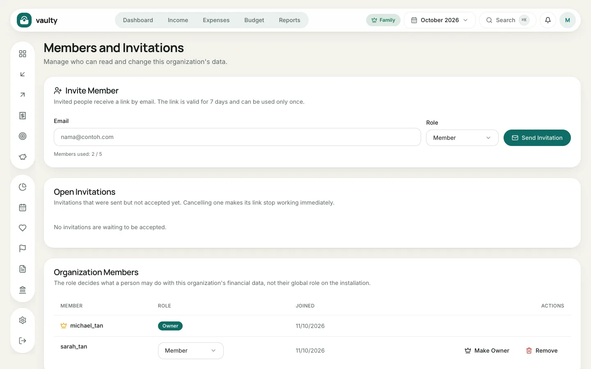

The **Family** plan lets up to **5 users** share one organization. Everyone sees the same data. Open it from the account menu and choose **Members**.

## Inviting a member

1. Enter the **Email** of the person you are inviting.
2. Choose a **Role**.
3. Click **Send Invitation**.

The person receives an email with a link that is **valid for 7 days and works only once**. Invitations not yet accepted show under **Open Invitations** and can be canceled (the link stops working right away). This list is only shown to Owners and Admins. The counter below the form shows the quota, for example "2 / 5".

An invitation can only be accepted by the owner of the invited email. The recipient must sign in with a Vaulty account whose email matches the invitation email and is verified. If the link is opened with any other account, Vaulty rejects it with an error saying the invitation is for a different email address, and the invitation stays open for the right owner. If the recipient wants to use another email, cancel the old invitation and send a new one to that address.

## Roles

| Role | Can |
|---|---|
| **Owner** | everything, including the subscription, AI agent access, and deleting the organization |
| **Admin** | record and change data, manage members, restore backups |
| **Member** | read, record, change, and delete financial data |
| **Viewer** | read only |

## Changing or removing a member

In the **Organization Members** table, change a role with the dropdown, or click **Remove** to take someone out. **Make Owner** transfers ownership of the organization to that member.

A removed member loses access right away, including any AI agent tokens they created.

## Invite codes and inviting many people (Family)

On the **Members** page you can invite up to **20 emails at once**. Or click **Create code** to make an **invite code**: pick the role, how many times it can be used (1 to 20), and how long it lasts (1 to 30 days). At most 10 codes can be active, and each can be revoked at any time. The person who receives a code enters it on the Members page. Attempts to enter a code are limited to 10 per 15 minutes.

## Sharing per account and budget (Family)

Owners and admins can limit an account or a budget to selected members, with the share button on its card. Members who are not selected do not see that account, its balance, its transfers, or its transactions, and also do not see it in the forecast, duplicate detection, backup export, or AI agents. Owners and admins always see everything.
