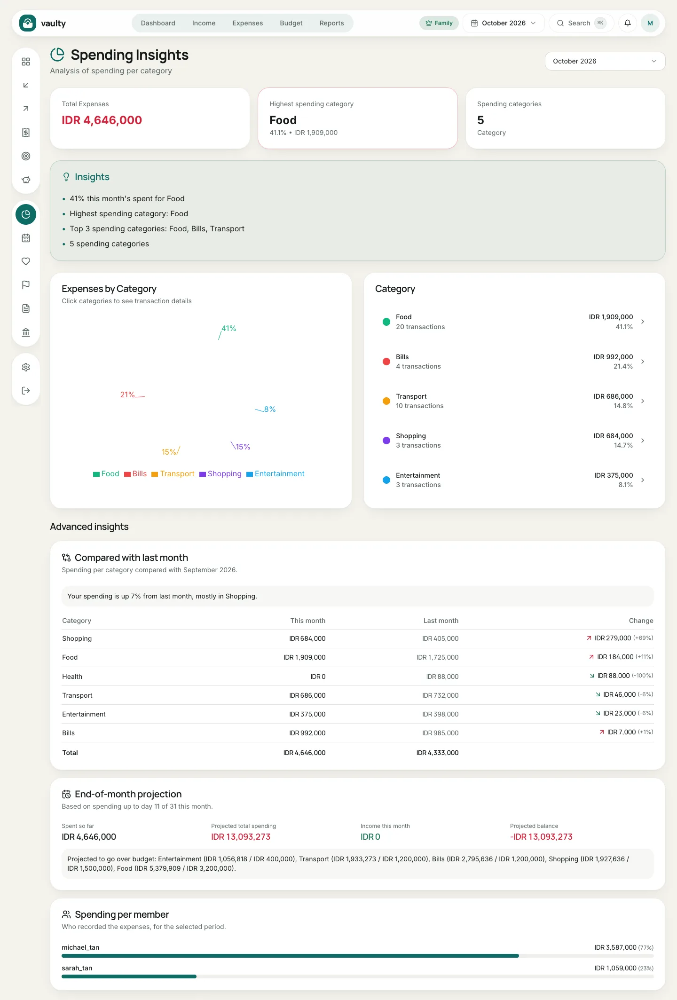
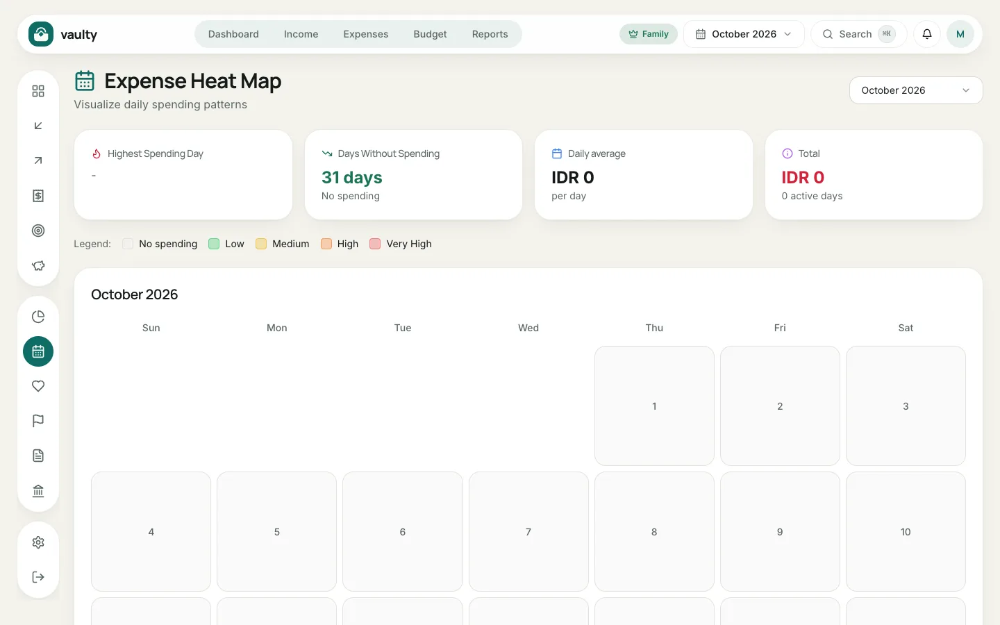
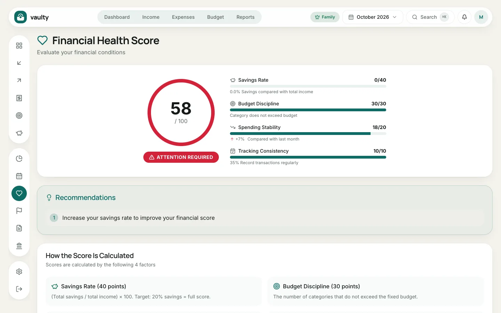

Three pages that help you read your data, not just record it.

## Spending Insights

This page shows your spending per category for the selected month: a pie chart, a ranking of categories, and a few automatic insight sentences. Click a category to see its transactions. Available on every plan.

### Advanced insights (Family plan)

At the bottom of the page, the Family plan adds three analyses:

1. **Compared with last month:** a per-category table (this month, last month, the change and its percentage) with a summary such as "your spending is up 40%, mostly in Food".
2. **End-of-month projection:** an estimate of total spending by month end based on the pace so far, compared with income, plus a list of budgeted categories projected to go over their limit. The projection only applies to the current month and appears after at least 5 days of data.
3. **Spending per member:** who recorded how much, useful for families.

Other plans see an upgrade hint here.

## Expense Heat Map

Available on the Personal plan and above.

The heat map shows **the days and times you spend the most**. A darker color means higher spending. It helps you spot habits, such as overspending on weekends.

## Financial Health Score

Available on the Personal plan and above.

A score from 0 to 100 built from four components:

| Component | Weight | What it measures |
|---|:---:|---|
| Savings Rate | 40 | savings compared with income (target 20%) |
| Budget Discipline | 30 | categories that stay within their budget |
| Spending Stability | 20 | how spending changed from last month |
| Tracking Consistency | 10 | how regularly you record transactions |

Below the score are **Recommendations** pointing to what to improve first.

### How each component is calculated

- **Savings Rate (40 points):** that month's savings (deposits minus withdrawals) divided by income. Savings of about 20% of income earns the full score. Withdrawals from savings do not count as income.
- **Budget Discipline (30 points):** the percentage of budgeted categories that stay within their limit. If you have not set any budget, you automatically get 15 out of 30, so creating budgets is the easiest way to raise this score.
- **Spending Stability (20 points):** compared with last month. Down or equal earns 20, up to 10% earns 18, up 10 to 25% earns 12, up 25 to 50% earns 6, and up more than 50% earns 2. With no data from last month you get 10.
- **Tracking Consistency (10 points):** the number of days in the month with a transaction. Ten days earns the full score.

### What the status means

| Score | Status | Meaning |
|---|---|---|
| 80 to 100 | **Healthy** | Enough savings, budgets under control, and steady spending. Keep it up. |
| 60 to 79 | **Moderate** | Decent, but some indicators can still improve. |
| 0 to 59 | **Attention required** | Several indicators need attention soon. |

Hover the **exclamation icon** on the status badge (on a phone, tap it). A comment-style bubble appears with what that status means and up to three things to do, taken from your weakest indicators. For example saving up to about 20% of income, cutting spending in categories over budget, setting a budget per category, or recording transactions more regularly.

An AI agent connected through MCP can also read this score with the `get_financial_health` tool, using the same formula.
