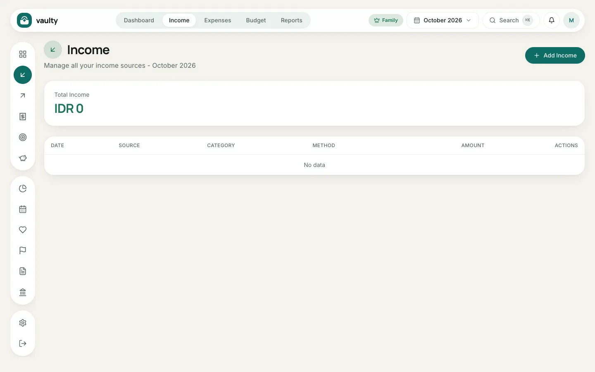
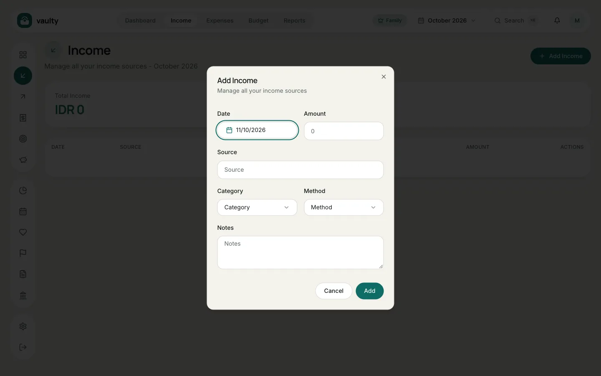

The **Income** menu holds all money coming in: salary, bonuses, freelance work, dividends, and more.

## Adding income

1. Open **Income** from the top menu or the icon on the left.
2. Click **Add Income**.
3. Fill in the form:
   - **Date** the money was received,
   - **Amount** in Rupiah,
   - **Source**, for example "Salary from Maju Bersama Ltd",
   - **Category** and **Method** (choices come from [Master data](/en/panduan/master-data/)),
   - **Notes** (optional).
4. Click **Add**.

## Editing or deleting

In the **Actions** column of each row there is a **pencil** icon to edit and a **trash** icon to delete. Deleted items go to the organization's trash so they can be restored.

## Tips

- Record fixed income (salary) on its real date so the monthly cash flow is accurate.
- The Free plan is limited to 50 transactions per month (income and expenses combined).

## Searching and saving filters

Above the table there is a search box (name, note, category, account) and a **Filter** button. The Filter panel narrows by **date** (the selected month, last 30 or 90 days, this year, last year, all time, or your own range), **minimum and maximum amount**, **category**, **account**, and **tag**.

Filters you use often can be saved: set the filter, open the Filter panel, click **Save filter**, and give it a name, for example "Online shopping over Rp500,000 this year". Saved filters appear as chips under the search box. One person can save up to 20 filters.

## Duplicate transactions

Vaulty looks for income that may have been recorded twice in the last 90 days: same amount and account, dates at most 3 days apart, similar names. When it finds some, a panel appears above the table. Choose **Keep the first** or **Keep the second** (the other goes to the trash for 30 days, and its tags and note are moved), or **Not a duplicate** so it is not offered again. Transactions linked to savings, bills, transfer fees, or splits are not offered.

## Exclude from reports

The form has an **Exclude from reports** switch. An excluded transaction shows an **Excluded** badge and is left out of reports, budgets, the health score, and insights. Account balances still count it, because the money really moved.
