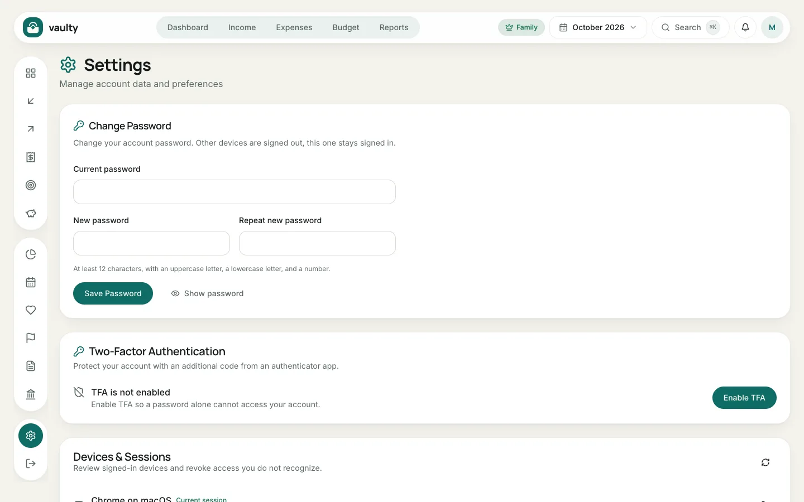
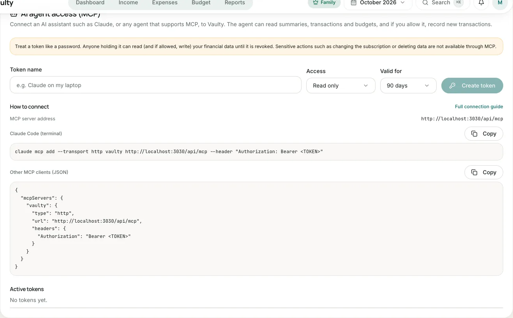

Open **Settings** from the gear icon on the left or the account menu. Each section below is a row you can expand, click its title to open it.

## Change password

Enter your current password, then the new one twice (at least 12 characters with an uppercase letter, a lowercase letter, and a number). Other devices are signed out automatically, this device stays signed in.

## Two-step verification (Personal and above)

Click **Enable 2FA**, scan the QR code with an authenticator app (the account is named "Vaulty"), enter the 6-digit code, and **keep the recovery codes** somewhere safe. From then on every sign-in needs a code from the app.

## Devices and sessions

The list of devices currently signed in. Click the sign-out icon next to a device you do not recognize to remove it.

## Install as an app

The **Install app** card helps you add Vaulty to your phone's home screen or your computer. On iPhone, follow the manual instructions shown.

## AI agent access (MCP)

Create a token to connect an AI assistant. The full guide is in [Connecting an AI agent](/en/agen-ai/menyambungkan-mcp/).

## Email notifications (Personal and above)

Set a destination address, then turn on **Send email** for bill due dates, budgets nearly used up, and debt installments (how many days ahead and the budget threshold can be set here too).

Turn on **Email on every transaction** to get an email each time you record an income or expense. Off by default. Fill in **Minimum amount** if you only want to hear about transactions above a certain amount, leave it empty for every amount.

The **Send Test Email** button confirms your SMTP setup works, and **Check Now** refreshes the list of alerts already sent.

## Language, appearance, and currency

- **Language:** Bahasa Indonesia or English. Every screen, email, report, and invoice follows this choice.
- **Appearance:** light or dark mode.
- **Display currency** (Personal and above): numbers are converted for display only, your stored data does not change.
- **Recording currency:** the actual currency your transactions are stored in, chosen the first time during onboarding. Only the organization owner can change it here. Changing it automatically converts all existing data (income, expenses, budgets, bills, savings, debts) at that day's exchange rate, so the real value stays the same even though the numbers change. If exchange rates cannot be fetched, the change is rejected until it can be retried. Switching to a currency other than the rupiah needs the Personal plan or above, while switching back to the rupiah is always allowed.

## Passkeys (all plans)

Under **Two-step verification** there is **Passkey**: sign in with your fingerprint, Face ID, or device PIN without typing a password.

1. Click **Add passkey**, name the device, and enter your **current password**.
2. Follow your device's prompt (fingerprint, Face ID, or PIN).
3. Next time, click **Sign in with a passkey** on the sign-in page.

Signing in with a passkey requires your fingerprint, Face ID, or PIN, so it already covers two factors and does not ask for a 2FA code. Your password, Google, and 2FA keep working. Vaulty only stores the public key; your fingerprint never leaves your device. One account can have up to 10 passkeys, and adding or removing one always asks for your password.

## Login history

Under **Devices and sessions** there is a **Login history** for the last 90 days, including attempts with a wrong password. IP addresses are partly masked. If your account is signed into from a new browser and operating system combination, Vaulty sends a **warning email**, so you can sign out all other sessions right away if it was not you.

## Notifications on this device

On the **Install app** card there is a **Notifications on this device** switch. When on, the same notifications as the bell in the app (bills due, budgets running out, insights, goals) also appear on your device even when Vaulty is closed. They only contain a short title and message. The switch is per device. On iPhone and iPad, add Vaulty to your Home Screen first, then open it from that icon. If the switch cannot be turned on, push notifications are not enabled on the server yet or notification permission was denied on your device.

## Summary email (Personal and above)

Under **Email notifications**, choose **Summary email**: **Off** (default), **Weekly** (every Monday), or **Monthly** (the 1st), around 07:00 Western Indonesia Time. It contains total income and expenses with the change from the previous period, the top spending category, bills in the next 7 days, and goal progress. Every email has a one click unsubscribe link.
