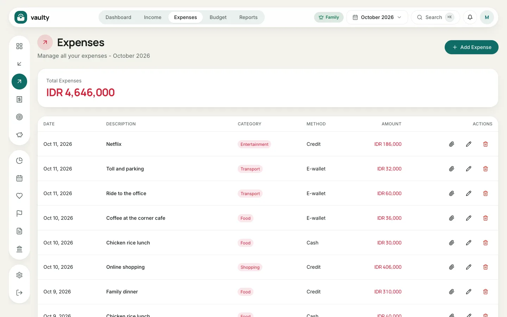
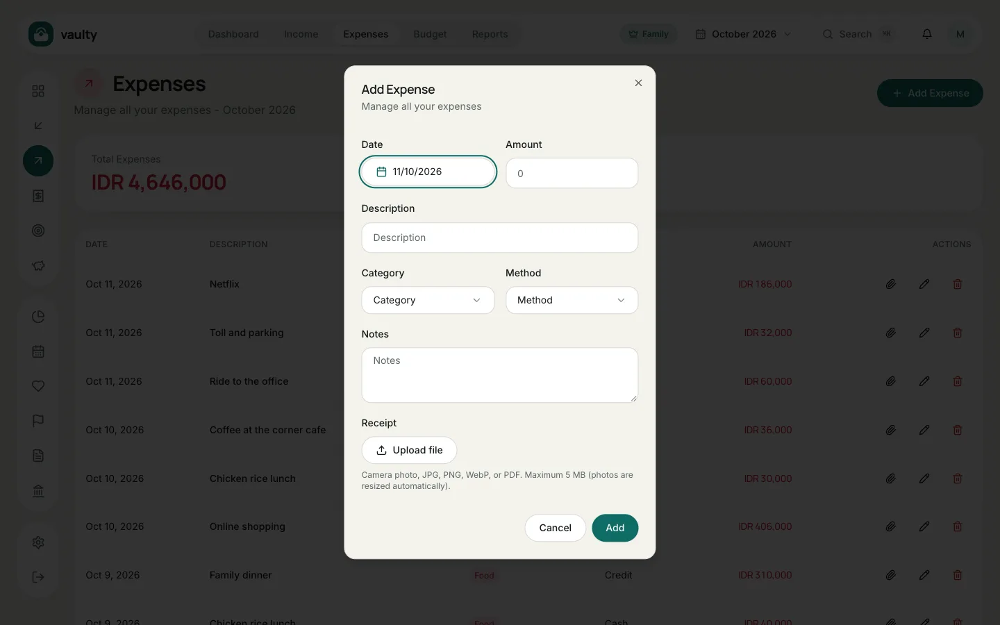
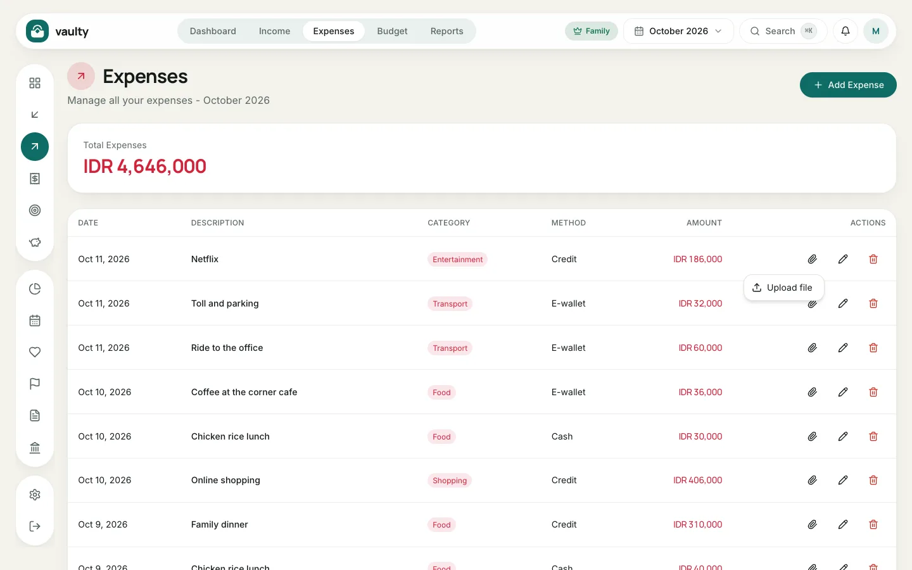

The **Expenses** menu holds all money going out, with category and payment method.

## Adding an expense

1. Open **Expenses**.
2. Click **Add Expense**.
3. Fill in **Date**, **Amount**, **Description**, **Category**, and **Method**. **Notes** can stay empty.
4. (Optional, Personal plan and above) In the **Proof** section, click **Upload file** to attach a receipt.
5. Click **Add**.

## Attaching a receipt to an existing expense

Click the **paperclip** icon in the **Actions** column of the row, then choose:

- **Take photo** with the rear camera (shown on phones and tablets), or
- **Upload file** for JPG, PNG, WebP, or PDF.

Photos from the camera are shrunk automatically in the browser so they fit the 5 MB limit.

## Tips

- Use consistent descriptions ("Fuel", not sometimes "filled up the tank"), so items are easy to search and group.
- If you often record the same thing, create a **Category Rule** in [Planning](/en/panduan/perencanaan/) so the category fills in by itself.

## Searching and saving filters

Above the table there is a search box (name, note, category, account) and a **Filter** button. The Filter panel narrows by **date** (the selected month, last 30 or 90 days, this year, last year, all time, or your own range), **minimum and maximum amount**, **category**, **account**, and **tag**.

Filters you use often can be saved: set the filter, open the Filter panel, click **Save filter**, and give it a name, for example "Online shopping over Rp500,000 this year". Saved filters appear as chips under the search box. One person can save up to 20 filters.

## Duplicate transactions

Vaulty looks for expenses that may have been recorded twice in the last 90 days: same amount and account, dates at most 3 days apart, similar names. When it finds some, a panel appears above the table. Choose **Keep the first** or **Keep the second** (the other goes to the trash for 30 days, and its tags and note are moved), or **Not a duplicate** so it is not offered again. Transactions linked to savings, bills, transfer fees, or splits are not offered.

## Exclude from reports

The form has an **Exclude from reports** switch. An excluded transaction shows an **Excluded** badge and is left out of reports, budgets, the health score, and insights. Account balances still count it, because the money really moved.

## Splitting and tagging

One receipt can be split across categories, and transactions can carry tags. See [Tags and split expenses](/en/panduan/tag-dan-pecahan/).
