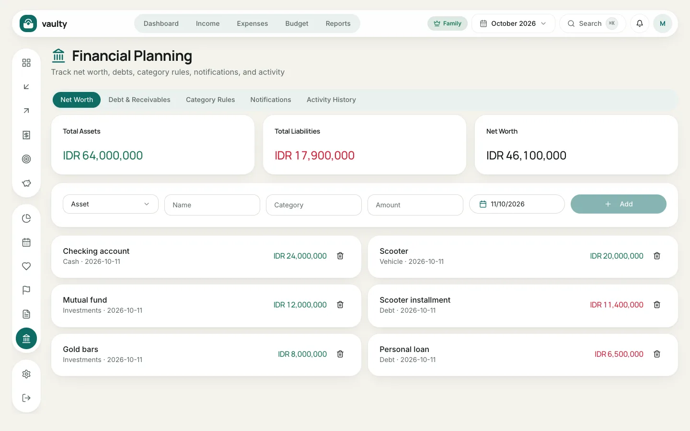
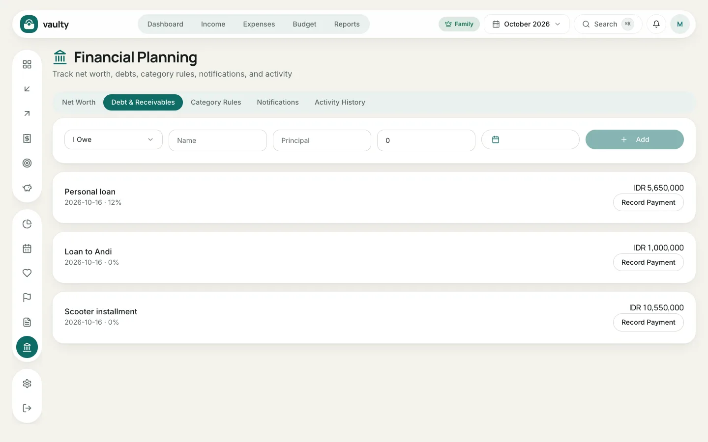
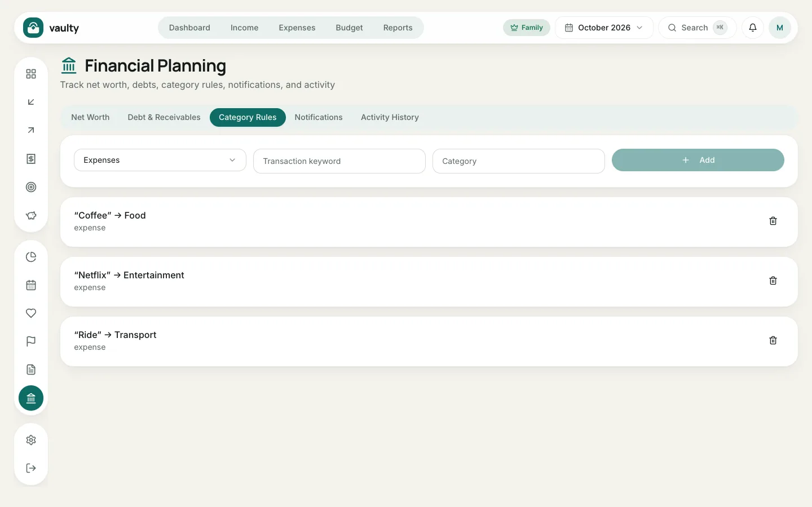

The **Planning** menu has four tabs. Debts and rules are on the **Personal** plan and above.

## Net Worth

Record **assets** (bank savings, mutual funds, gold, vehicles) and **liabilities** (debts). The cards at the top show **Total Assets**, **Total Liabilities**, and **Net Worth** (assets minus liabilities).

1. Choose **Asset** or **Liability**.
2. Fill in **Name**, **Category**, **Amount**, and the value date.
3. Click **Add**. Update the values regularly so the numbers stay right.

## Debt & Receivables

1. Choose **I Owe** (you owe money) or a receivable (someone owes you).
2. Fill in **Name**, **Principal** (the starting amount), the remaining amount, and the due date.
3. Click **Add**.
4. Each time you pay an installment, click **Record Payment** and enter the amount. The remaining debt goes down automatically.

## Category Rules

Rules fill in the category automatically from keywords in the description. For example, the word "Ride" always goes to the Transport category. Create rules for transactions that repeat often so recording is faster.

## Activity History

A record of every change in the organization: who added, changed, or deleted what, and when. Useful for families sharing data.

## Net worth breakdown

Net worth is worked out from your account balances, the assets you record, **crypto**, and receivables, minus credit card balances, liabilities, and remaining debt. A credit card in the negative counts as a liability. This tab also lists your credit cards (used, remaining limit, statement and due dates) and a chart of your asset values over time. Crypto values are tracked in the [Crypto](/en/panduan/kripto/) menu.

## Loan simulator

On the **Debts & Receivables** tab, the **Loan simulator** button opens a calculator, and the **Simulate** button on each debt opens it with the remaining principal and rate already filled in.

1. Enter the **remaining principal**, **yearly interest**, and the **term** in months.
2. Pick the interest method: **effective or annuity** (mortgages and most banks) or **flat** (vehicles, personal loans, installments).
3. See the **monthly payment**, total interest, total paid, and a **payment schedule** that splits principal and interest each month.
4. Enter **extra payment per month** to see how many months sooner it is paid off and how much interest you save.

The figures are estimates, and real results can differ depending on the lender's rules. The simulator does not save or change your debt records.

## Advanced rules

Rules that can change the category, name, or tags, exclude a transaction from reports, record it as a transfer, or send an email are in [Automatic rules](/en/panduan/aturan-otomatis/).
