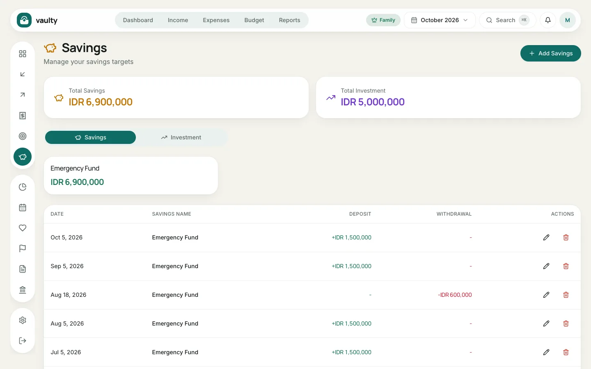
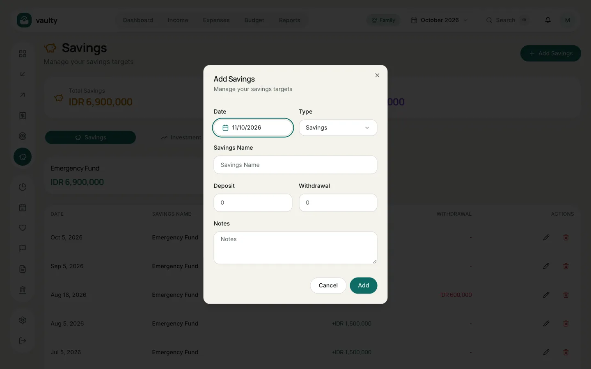
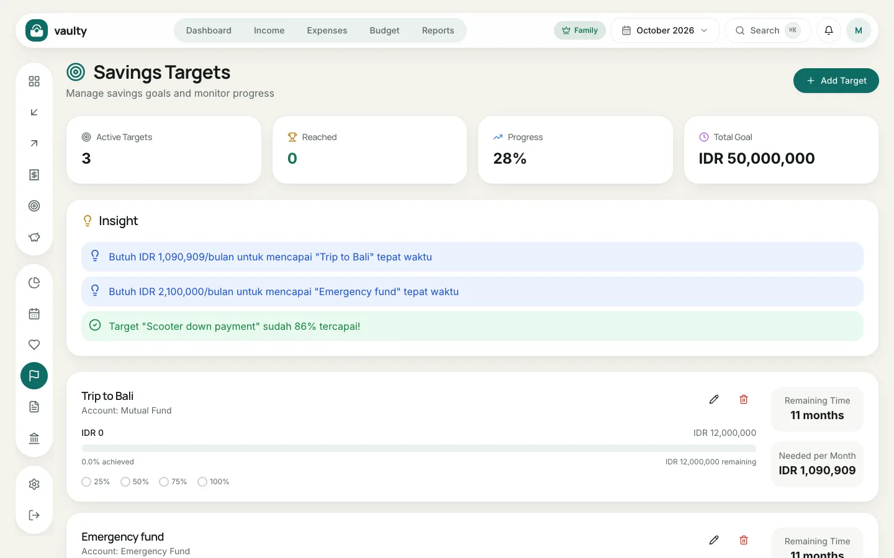
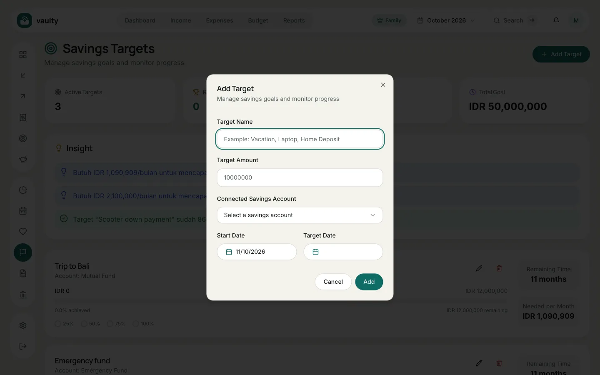

Two menus that work as a pair: **Savings** for recording money saved or invested, and **Goals** for what you want to reach. Both are on the **Personal** plan and above.

## Recording savings

1. Open **Savings** and click **Add Savings**.
2. Choose the **Date** and **Type** (**Savings** or **Investments**).
3. Enter the **Savings Name**, for example "Emergency Fund" or "Mutual Fund". If that name was used before, it shows up as a suggestion under the field, so you don't have to retype it and it doesn't get recorded as a separate account over a spelling difference.
4. Enter a **Deposit** for money going in, or a **Withdrawal** for money taken out. Thousand separators appear automatically as you type, so large amounts stay easy to read.
5. Click **Add**.

Each account's balance is deposits minus withdrawals, shown on the cards above the list. A withdrawal cannot be larger than the account's balance. If it is, Vaulty rejects the entry and shows the available balance, so an account balance never goes below zero.

Money you withdraw from savings or investments goes into your wallet balance, but it is **not counted as income**. Total Income, the cash flow chart, and the financial health score only count money that is genuinely new, like salary or a bonus.

## Creating a goal

1. Open **Goals** and click **Add Target**.
2. Enter the **Target Name** (for example "Trip to Bali") and the **Target Amount**.
3. Choose the **Connected Savings Account**: that account's balance counts as progress.
4. Pick the **Start Date** and **Target Date**.
5. Click **Add**.

Each goal shows progress, **Remaining Time**, and **Needed per Month**: how much to save every month to arrive on time. The **Insight** section at the top tells you which goals are nearly done.

## Recurring set-aside for a goal (Personal and above)

On a goal card, **Recurring set-aside** sets a fixed amount to put aside each month on a chosen day, or every time your salary arrives. On that day Vaulty reminds you, then you click **Set aside** and a transfer to the goal's account is recorded. The **automatic** mode is only for people who use auto-debit, because Vaulty records money and does not move it.

## Shared goals (Family)

Link a goal to an account, and family members can make **pledges**: how much and by when. A pledge is **kept** when that member records a transfer to the goal's account between 31 days before and 7 days after the due date, with an amount within 1%. After 7 days without a transfer, the pledge is marked **overdue**. The goal panel shows each member's progress.

Money that **leaves** the goal's account (outgoing transfers or expenses) goes into a list that needs an explanation. Members answer what it was for: the goal, borrowed and to be returned, or something else with a note. Accounts used day to day (cash, e-wallets, or many expenses) get a warning, because shared savings are best kept in a dedicated account.
