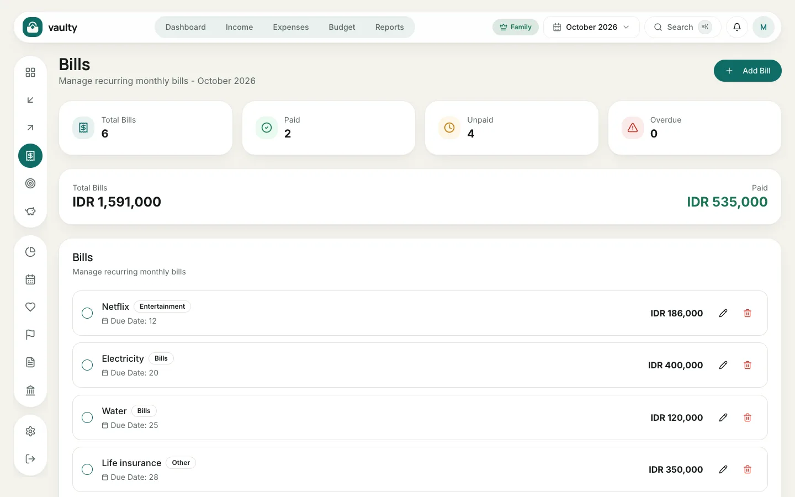
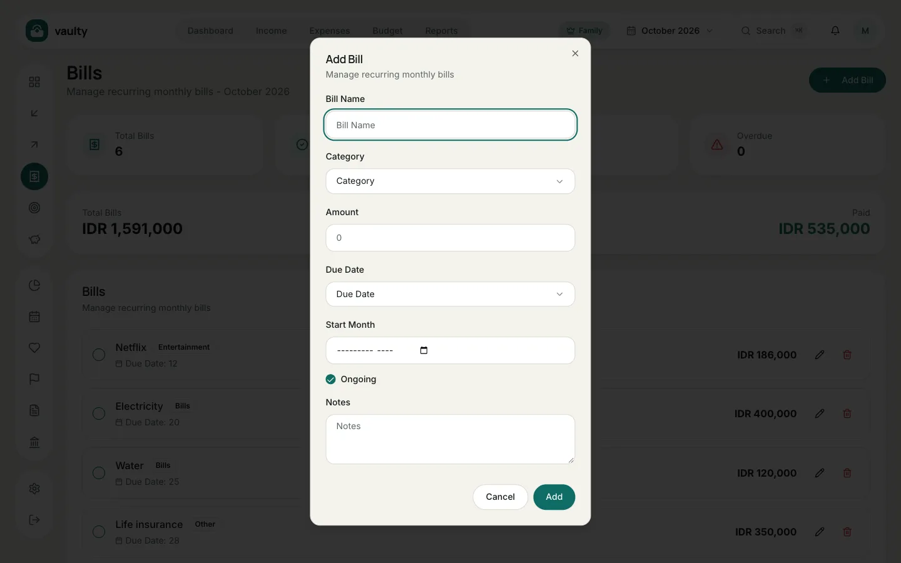

**Bills** is for regular expenses such as electricity, internet, and subscriptions, so none slip by. Available on the **Personal** plan and above.

## Adding a bill

1. Open **Bills** and click **Add Bill**.
2. Fill in **Bill Name**, **Category**, and **Amount**.
3. Choose the **Due Date** (1 to 31) and **Start Month**.
4. Leave **Ongoing** on for a bill with no end date, or turn it off and set an end month.
5. Click **Add**.

## Marking it paid

Click the circle to the left of the bill name. The bill becomes **Paid** (struck through), and the payment is recorded as an expense for that month. The amount paid must equal the bill amount. A payment with any other amount is rejected, so a bill cannot be marked paid with the wrong amount.

## Reading the summary

The four cards at the top show **Total Bills**, **Paid**, **Unpaid**, and **Overdue**. A bill past its due date without payment gets a red **Overdue** label, and bills nearing their due date show up in the **Upcoming bills** card on the dashboard.

## Bills we found

When your spending looks like a recurring bill (at least 3 times in different months, 25 to 35 days apart, similar amounts), Vaulty offers it in the **Bills we found** panel. Click **Accept** to make it a bill, or **Dismiss** so it is not suggested again. **Find bills** checks again right now; Vaulty also checks by itself every 6 hours.

Once accepted, matching expenses from the last 40 days are recorded as that month's payment. If the price goes up and the last two payments are already at the new price, a detected bill is updated automatically, while a bill you created yourself only gets a notice with the choice **Use the new price** or **Keep it**.

## Bill calendar in your calendar app

Click **Create calendar link**, then add it to Google Calendar, Apple Calendar, or Outlook with "add calendar from URL". Your active bills show up in the calendar, from 2 months back to 12 months ahead. Paid months get a check mark, and unpaid bills get a reminder the day before.

The link is shown **only once** and is secret, so keep it safe. **Create new link** revokes the old one immediately, and **Turn off** stops it entirely.
