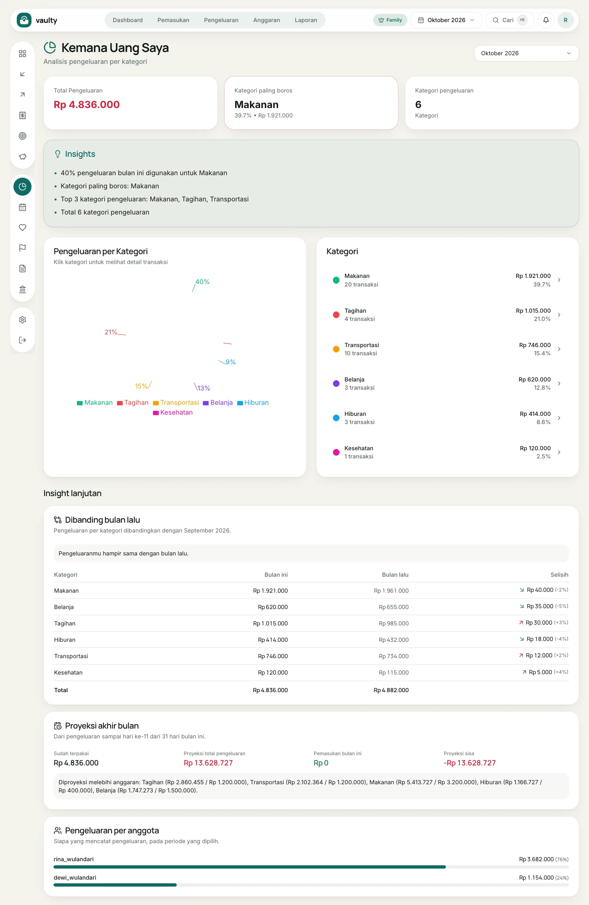
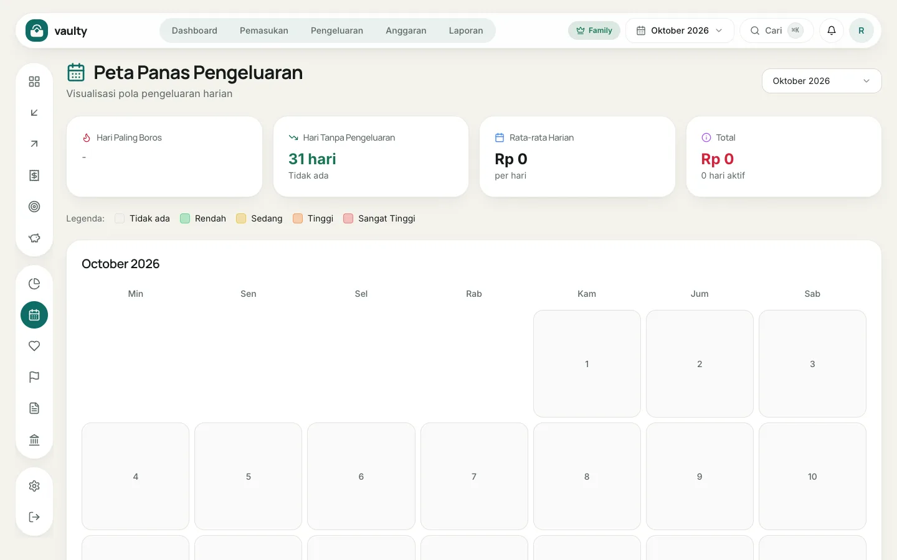
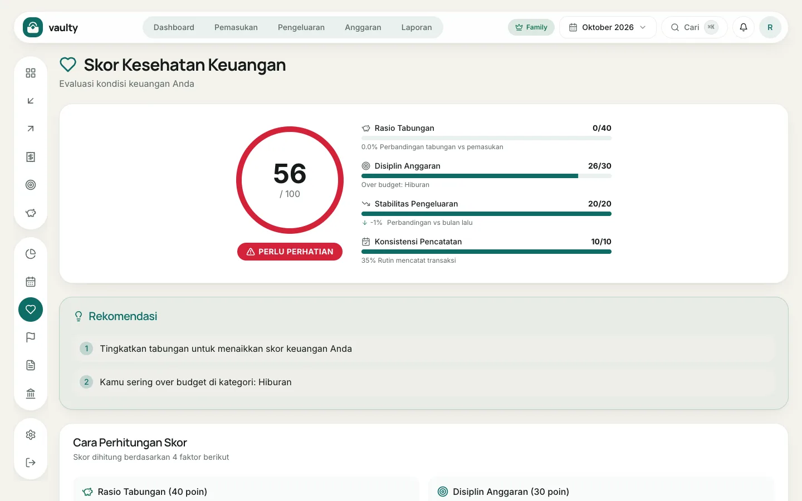

Tiga halaman yang membantu membaca datamu, bukan sekadar mencatatnya.

## Kemana Uang Saya (Insight)

Halaman ini menunjukkan pengeluaranmu per kategori untuk bulan yang dipilih: grafik lingkaran, peringkat kategori, dan beberapa kalimat insight otomatis. Klik sebuah kategori untuk melihat transaksinya. Tersedia di semua paket.

### Insight lanjutan (paket Family)

Di bagian bawah halaman, paket Family mendapat tiga analisis tambahan:

1. **Dibanding bulan lalu:** tabel per kategori (bulan ini, bulan lalu, selisih dan persentasenya) dengan ringkasan seperti "pengeluaranmu naik 40%, terutama di Makanan".
2. **Proyeksi akhir bulan:** perkiraan total pengeluaran sampai akhir bulan berdasarkan laju sejauh ini, dibandingkan dengan pemasukan, dan daftar kategori beranggaran yang diproyeksi melebihi batasnya. Proyeksi hanya untuk bulan berjalan dan baru muncul setelah ada data minimal 5 hari.
3. **Pengeluaran per anggota:** siapa mencatat berapa, berguna untuk keluarga.

Paket lain melihat ajakan untuk upgrade di bagian ini.

## Peta panas

Tersedia di paket Personal ke atas.

Peta panas menunjukkan **hari dan waktu pengeluaranmu paling banyak**. Warna lebih pekat berarti pengeluaran lebih besar. Berguna untuk menemukan kebiasaan, misalnya belanja berlebihan di akhir pekan.

## Skor kesehatan keuangan

Tersedia di paket Personal ke atas.

Skor 0 sampai 100 dari empat komponen:

| Komponen | Bobot | Yang dinilai |
|---|:---:|---|
| Rasio Tabungan | 40 | tabungan dibanding pemasukan (target 20%) |
| Disiplin Anggaran | 30 | kategori yang tidak melewati anggaran |
| Stabilitas Pengeluaran | 20 | perubahan pengeluaran dibanding bulan lalu |
| Konsistensi Pencatatan | 10 | seberapa rutin kamu mencatat |

Di bawah skor ada **Rekomendasi** yang menunjukkan hal paling berpengaruh untuk diperbaiki.

### Cara tiap komponen dihitung

- **Rasio Tabungan (40 poin):** tabungan bulan itu (setoran dikurangi penarikan) dibagi pemasukan. Tabungan sekitar 20% dari pemasukan sudah dapat nilai penuh. Penarikan dari tabungan tidak dihitung sebagai pemasukan.
- **Disiplin Anggaran (30 poin):** persentase kategori anggaran yang tidak melewati batas. Kalau kamu belum membuat anggaran sama sekali, kamu otomatis mendapat 15 dari 30, jadi membuat anggaran adalah cara paling mudah menaikkan skor ini.
- **Stabilitas Pengeluaran (20 poin):** dibanding bulan lalu. Turun atau sama dapat 20, naik sampai 10% dapat 18, naik 10 sampai 25% dapat 12, naik 25 sampai 50% dapat 6, dan naik lebih dari 50% dapat 2. Tanpa data bulan lalu kamu mendapat 10.
- **Konsistensi Pencatatan (10 poin):** jumlah hari dalam sebulan yang ada transaksinya. Sepuluh hari sudah nilai penuh.

### Arti status

| Skor | Status | Artinya |
|---|---|---|
| 80 sampai 100 | **Sehat** | Tabungan cukup, anggaran terjaga, dan pengeluaran stabil. Pertahankan. |
| 60 sampai 79 | **Cukup** | Lumayan, tapi masih ada indikator yang bisa diperbaiki. |
| 0 sampai 59 | **Perlu Perhatian** | Beberapa indikator perlu segera dibenahi. |

Arahkan kursor ke **ikon tanda seru** di badge status (di HP, ketuk ikonnya). Muncul balon komentar berisi arti status itu dan sampai tiga langkah yang perlu dilakukan, diambil dari indikator yang paling lemah. Misalnya menabung sampai sekitar 20% dari pemasukan, mengurangi pengeluaran di kategori yang melebihi anggaran, membuat anggaran per kategori, atau mencatat transaksi lebih rutin.

Agen AI yang tersambung lewat MCP juga bisa membaca skor ini dengan alat `get_financial_health`, dengan rumus yang sama.
