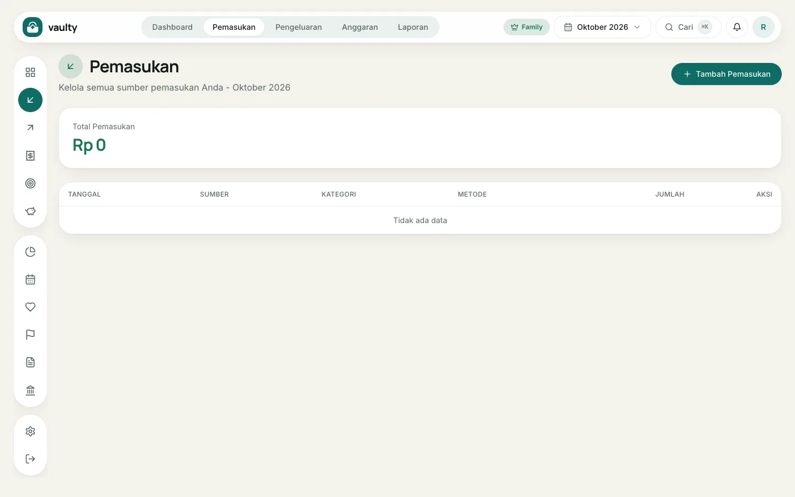
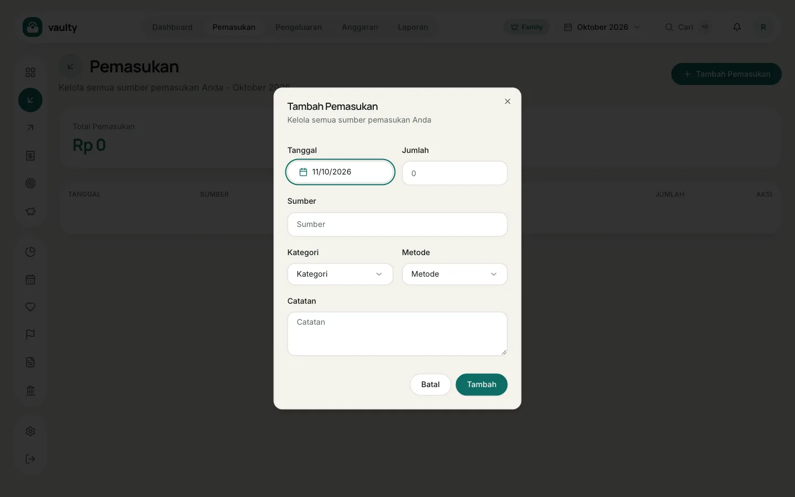

Menu **Pemasukan** berisi semua uang masuk: gaji, bonus, hasil freelance, dividen, dan lainnya.

## Menambah pemasukan

1. Buka **Pemasukan** dari menu atas atau ikon di sisi kiri.
2. Klik **Tambah Pemasukan**.
3. Isi formulir:
   - **Tanggal** kapan uang diterima,
   - **Jumlah** dalam Rupiah,
   - **Sumber**, misalnya "Gaji PT Maju Bersama",
   - **Kategori** dan **Metode** (pilihan berasal dari [Master data](/panduan/master-data/)),
   - **Catatan** (opsional).
4. Klik **Tambah**.

## Mengubah atau menghapus

Di kolom **Aksi** pada tiap baris ada ikon **pensil** untuk mengubah dan ikon **tempat sampah** untuk menghapus. Yang dihapus masuk ke kotak sampah organisasi sehingga bisa dipulihkan.

## Tips

- Catat pemasukan tetap (gaji) di tanggal sebenarnya supaya arus kas bulanan akurat.
- Paket Gratis dibatasi 50 transaksi per bulan (pemasukan dan pengeluaran digabung).

## Mencari dan menyimpan filter

Di atas tabel ada kotak cari (nama, catatan, kategori, rekening) dan tombol **Filter**. Di panel Filter kamu bisa menyaring menurut **tanggal** (bulan yang dipilih, 30 atau 90 hari terakhir, tahun ini, tahun lalu, semua, atau rentang sendiri), **jumlah minimal dan maksimal**, **kategori**, **rekening**, dan **tag**.

Filter yang sering dipakai bisa disimpan: atur filternya, buka panel Filter, klik **Simpan filter**, lalu beri nama, misalnya "Belanja online di atas Rp500.000 tahun ini". Filter tersimpan tampil sebagai chip di bawah kotak cari. Satu orang boleh menyimpan paling banyak 20 filter.

## Transaksi ganda

Vaulty mencari pemasukan yang kemungkinan tercatat dua kali dalam 90 hari terakhir: jumlah dan rekening sama, tanggal paling jauh 3 hari, nama mirip. Kalau ada, panel muncul di atas tabel. Pilih **Simpan yang pertama** atau **Simpan yang kedua** (yang satunya masuk tong sampah 30 hari, tag dan catatannya dipindah), atau **Bukan ganda** supaya tidak ditawarkan lagi. Transaksi yang terhubung ke tabungan, tagihan, biaya transfer, atau pecahan tidak ditawarkan.

## Kecualikan dari laporan

Di form ada sakelar **Kecualikan dari laporan**. Transaksi yang dikecualikan tampil dengan lencana **Dikecualikan** dan tidak dihitung di laporan, anggaran, skor kesehatan, dan insight. Saldo rekening tetap menghitungnya, karena uangnya memang bergerak.
