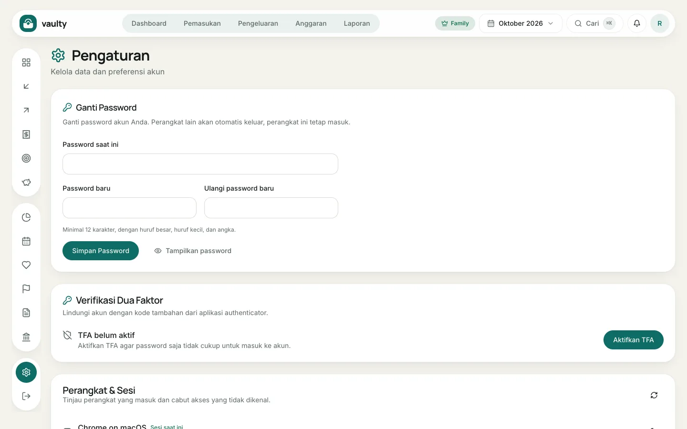
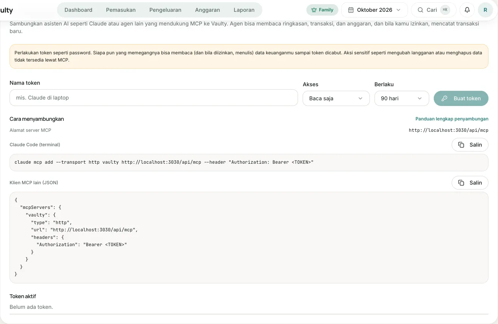

Buka **Pengaturan** dari ikon roda gigi di sisi kiri atau menu akun. Tiap bagian di bawah ini tersusun sebagai baris yang bisa dibuka tutup, klik judulnya untuk membuka.

## Ganti password

Isi password saat ini, lalu password baru dua kali (minimal 12 karakter dengan huruf besar, huruf kecil, dan angka). Perangkat lain otomatis keluar, perangkat ini tetap masuk.

## Verifikasi dua langkah (Personal ke atas)

Klik **Aktifkan TFA**, pindai kode QR dengan aplikasi authenticator (nama akunnya "Vaulty"), masukkan kode 6 digit, lalu **simpan kode pemulihan** di tempat aman. Setelah itu setiap masuk butuh kode dari aplikasi.

## Perangkat dan sesi

Daftar perangkat yang sedang masuk. Klik ikon keluar di samping perangkat yang tidak kamu kenali untuk mengeluarkannya.

## Pasang sebagai aplikasi

Kartu **Pasang aplikasi** membantu menambahkan Vaulty ke layar utama ponsel atau komputer. Di iPhone, ikuti petunjuk manual yang tampil.

## Akses agen AI (MCP)

Buat token untuk menyambungkan asisten AI. Panduan lengkapnya ada di [Menyambungkan agen AI](/agen-ai/menyambungkan-mcp/).

## Notifikasi Email (Personal ke atas)

Atur alamat tujuan, lalu nyalakan **Kirim email** untuk pengingat tagihan jatuh tempo, anggaran hampir habis, dan cicilan utang (berapa hari sebelumnya dan ambang anggaran bisa diatur di sini juga).

Nyalakan **Email tiap transaksi tercatat** kalau mau dapat email setiap kali mencatat pemasukan atau pengeluaran. Mati secara bawaan. Isi **Nominal minimum** kalau cuma mau dikabari untuk transaksi di atas jumlah tertentu, kosongkan untuk semua nominal.

Tombol **Kirim Email Test** memastikan pengaturan SMTP-nya benar, dan **Periksa Sekarang** memuat ulang daftar peringatan yang sudah dikirim.

## Bahasa, tampilan, dan mata uang

- **Bahasa:** Bahasa Indonesia atau English. Semua layar, email, laporan, dan invoice mengikuti pilihan ini.
- **Tampilan:** mode terang atau gelap.
- **Mata uang tampilan** (Personal ke atas): angka dikonversi untuk ditampilkan saja, tidak mengubah data tersimpan.
- **Mata uang pencatatan:** mata uang asli tempat seluruh transaksi disimpan, dipilih pertama kali saat onboarding. Hanya pemilik organisasi yang bisa menggantinya di sini. Kalau diganti, seluruh data lama (pemasukan, pengeluaran, anggaran, tagihan, tabungan, utang) otomatis dikonversi memakai kurs hari itu, supaya nilai riilnya tetap sama walau angkanya berubah. Kalau kurs sedang tidak bisa diambil, penggantian ditolak sampai bisa dicoba lagi.
