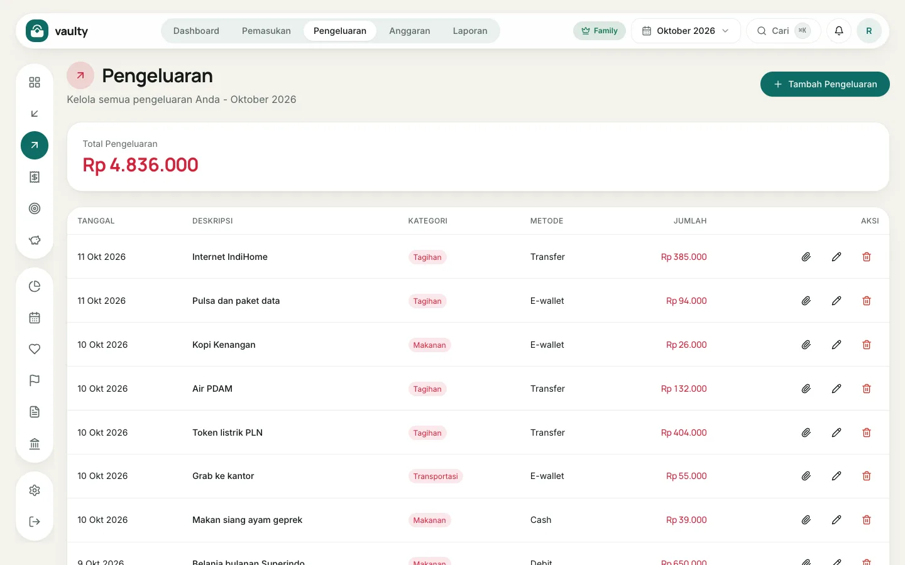
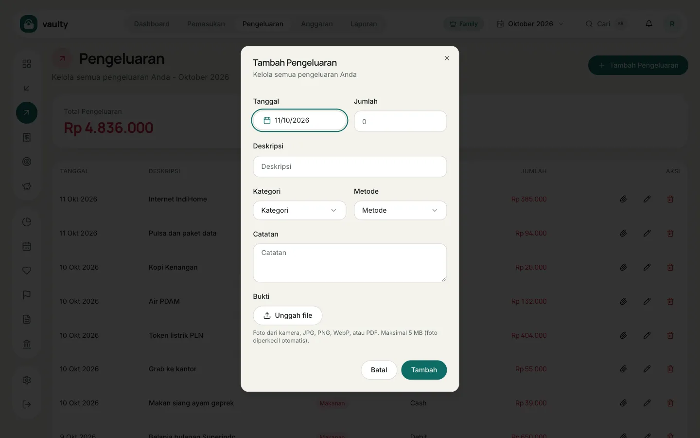
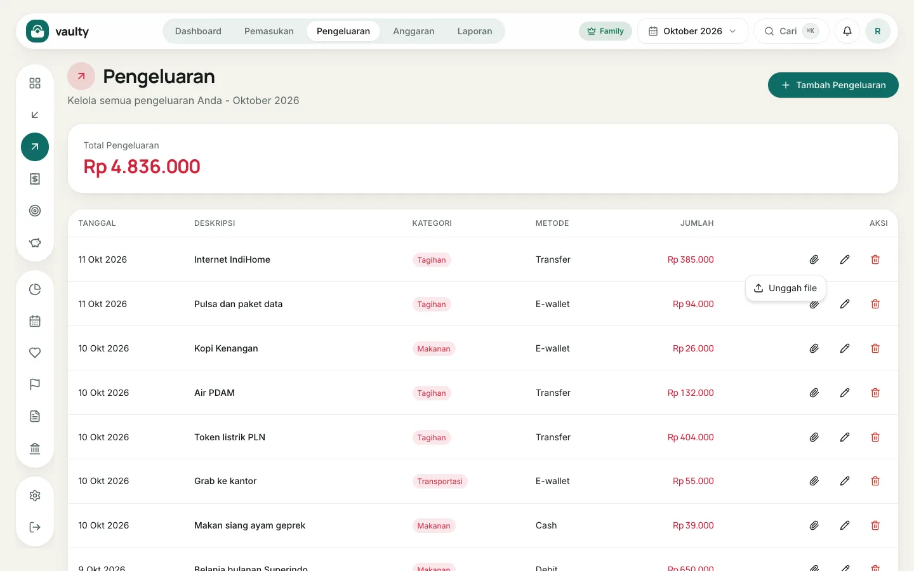

Menu **Pengeluaran** berisi semua uang keluar, lengkap dengan kategori dan metode pembayaran.

## Menambah pengeluaran

1. Buka **Pengeluaran**.
2. Klik **Tambah Pengeluaran**.
3. Isi **Tanggal**, **Jumlah**, **Deskripsi**, **Kategori**, dan **Metode**. **Catatan** boleh dikosongkan.
4. (Opsional, paket Personal ke atas) Di bagian **Bukti**, klik **Unggah file** untuk melampirkan struk.
5. Klik **Tambah**.

## Melampirkan struk ke pengeluaran yang sudah ada

Klik ikon **klip** di kolom **Aksi** pada baris yang dimaksud, lalu pilih:

- **Ambil foto** memakai kamera belakang (tampil di ponsel atau tablet), atau
- **Unggah file** untuk JPG, PNG, WebP, atau PDF.

Foto dari kamera diperkecil otomatis di browser supaya lolos batas 5 MB.

## Tips

- Pakai deskripsi yang konsisten ("Bensin Pertamax", bukan kadang "isi bensin"), supaya mudah dicari dan dikelompokkan.
- Kalau sering mencatat hal yang sama, buat **Aturan Kategori** di menu [Perencanaan](/panduan/perencanaan/) agar kategorinya terisi otomatis.

## Mencari dan menyimpan filter

Di atas tabel ada kotak cari (nama, catatan, kategori, rekening) dan tombol **Filter**. Di panel Filter kamu bisa menyaring menurut **tanggal** (bulan yang dipilih, 30 atau 90 hari terakhir, tahun ini, tahun lalu, semua, atau rentang sendiri), **jumlah minimal dan maksimal**, **kategori**, **rekening**, dan **tag**.

Filter yang sering dipakai bisa disimpan: atur filternya, buka panel Filter, klik **Simpan filter**, lalu beri nama, misalnya "Belanja online di atas Rp500.000 tahun ini". Filter tersimpan tampil sebagai chip di bawah kotak cari. Satu orang boleh menyimpan paling banyak 20 filter.

## Transaksi ganda

Vaulty mencari pengeluaran yang kemungkinan tercatat dua kali dalam 90 hari terakhir: jumlah dan rekening sama, tanggal paling jauh 3 hari, nama mirip. Kalau ada, panel muncul di atas tabel. Pilih **Simpan yang pertama** atau **Simpan yang kedua** (yang satunya masuk tong sampah 30 hari, tag dan catatannya dipindah), atau **Bukan ganda** supaya tidak ditawarkan lagi. Transaksi yang terhubung ke tabungan, tagihan, biaya transfer, atau pecahan tidak ditawarkan.

## Kecualikan dari laporan

Di form ada sakelar **Kecualikan dari laporan**. Transaksi yang dikecualikan tampil dengan lencana **Dikecualikan** dan tidak dihitung di laporan, anggaran, skor kesehatan, dan insight. Saldo rekening tetap menghitungnya, karena uangnya memang bergerak.

## Memecah dan memberi tag

Satu struk bisa dipecah ke beberapa kategori, dan transaksi bisa diberi tag. Lihat [Tag dan pecahan pengeluaran](/panduan/tag-dan-pecahan/).
