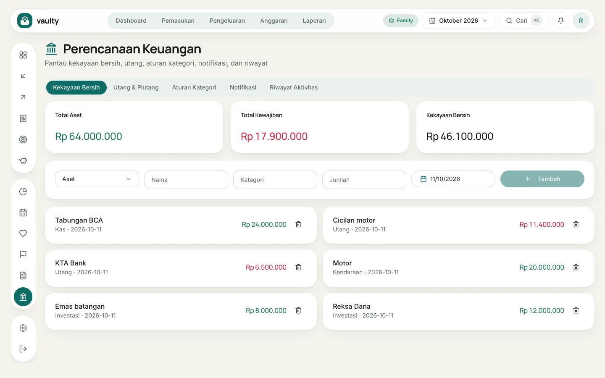
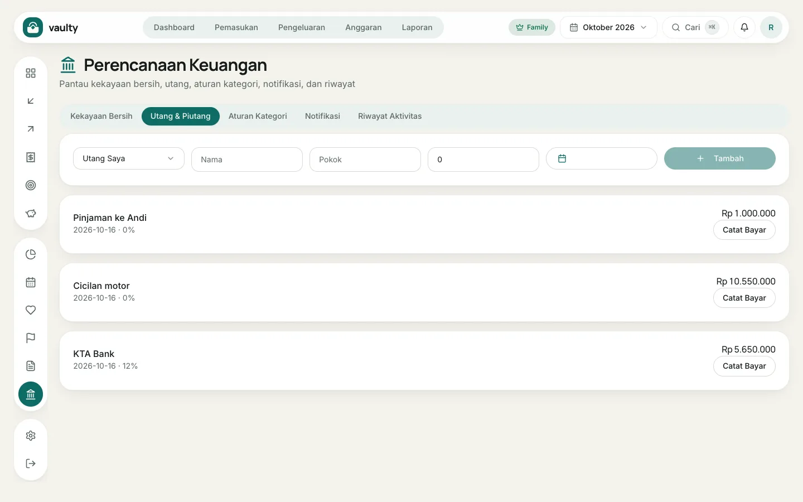
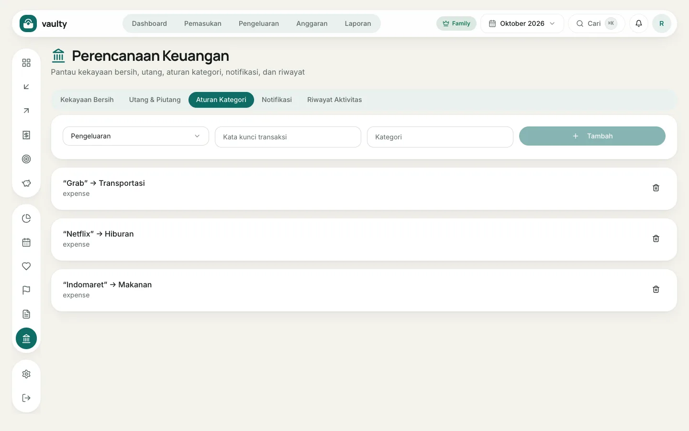

Menu **Perencanaan** punya empat tab. Bagian utang dan aturan tersedia di paket **Personal** ke atas.

## Kekayaan Bersih

Catat **aset** (tabungan bank, reksa dana, emas, kendaraan) dan **kewajiban** (utang). Kolom di atas kartu menunjukkan **Total Aset**, **Total Kewajiban**, dan **Kekayaan Bersih** (aset dikurangi kewajiban).

1. Pilih **Aset** atau **Kewajiban**.
2. Isi **Nama**, **Kategori**, **Jumlah**, dan tanggal nilainya.
3. Klik **Tambah**. Perbarui nilainya berkala supaya angkanya tetap benar.

## Utang & Piutang

1. Pilih **Utang Saya** (kamu berutang) atau piutang (orang lain berutang padamu).
2. Isi **Nama**, **Pokok** (jumlah awal), sisa, dan tanggal jatuh tempo.
3. Klik **Tambah**.
4. Setiap ada cicilan, klik **Catat Bayar** dan isi jumlahnya. Sisa utang berkurang otomatis.

## Aturan Kategori

Aturan mengisi kategori otomatis dari kata kunci deskripsi. Misalnya kata "Grab" selalu masuk kategori Transportasi. Buat aturan untuk transaksi yang sering berulang supaya pencatatan lebih cepat.

## Riwayat Aktivitas

Catatan semua perubahan di organisasi: siapa menambah, mengubah, atau menghapus apa, dan kapan. Berguna untuk keluarga yang berbagi data. Baris tentang undangan dan keanggotaan hanya tampil untuk Owner dan Admin.

## Rincian kekayaan bersih

Kekayaan bersih dihitung dari saldo rekening, aset yang kamu catat, **kripto**, dan piutang, dikurangi tagihan kartu kredit, kewajiban, dan sisa utang. Kartu kredit yang minus dihitung sebagai kewajiban. Tab ini juga menampilkan daftar kartu kredit (terpakai, sisa limit, tanggal cetak dan jatuh tempo) dan grafik riwayat nilai asetmu. Nilai kripto dicatat di menu [Kripto](/panduan/kripto/).

## Simulasi cicilan

Di tab **Utang & Piutang**, tombol **Simulasi cicilan** membuka kalkulator, dan tombol **Simulasi** di setiap utang membukanya dengan sisa pokok dan bunga yang sudah terisi.

1. Isi **sisa pokok**, **bunga per tahun**, dan **lama cicilan** dalam bulan.
2. Pilih cara hitung bunga: **efektif atau anuitas** (KPR dan kebanyakan bank) atau **flat** (kendaraan, KTA, cicilan barang).
3. Lihat **cicilan per bulan**, total bunga, total dibayar, dan **jadwal angsuran** yang memisahkan pokok dan bunga tiap bulan.
4. Isi **bayar lebih per bulan** untuk melihat lunas berapa bulan lebih cepat dan berapa bunga yang dihemat.

Angkanya perkiraan, dan hasil sebenarnya bisa berbeda menurut aturan pemberi pinjaman. Simulasi tidak menyimpan atau mengubah data utangmu.

## Aturan lanjutan

Aturan yang bisa mengubah kategori, nama, tag, mengecualikan transaksi dari laporan, menjadikannya transfer, atau mengirim email ada di [Aturan otomatis](/panduan/aturan-otomatis/).
