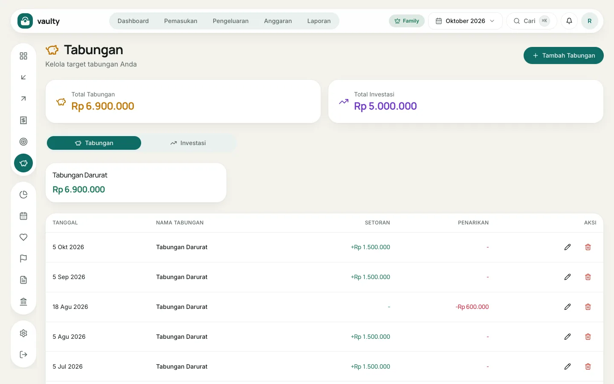
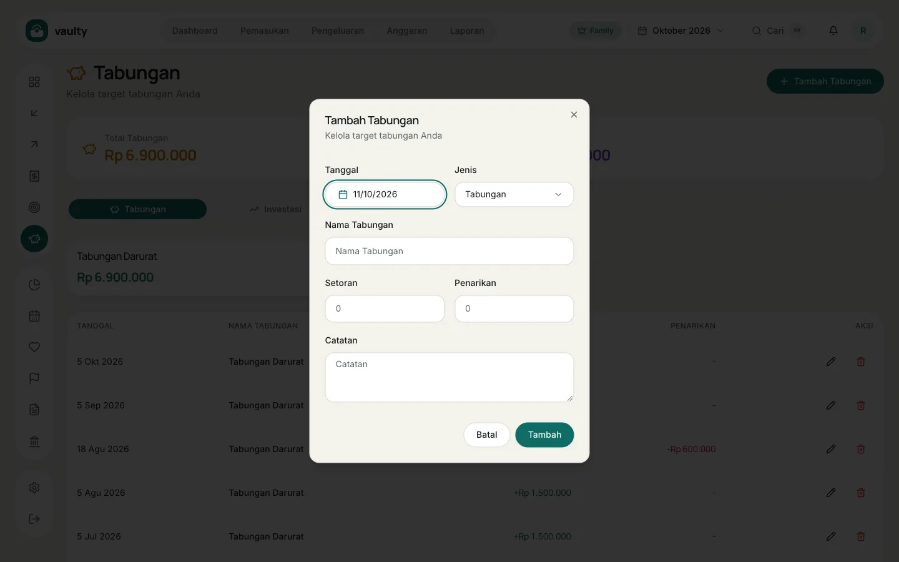
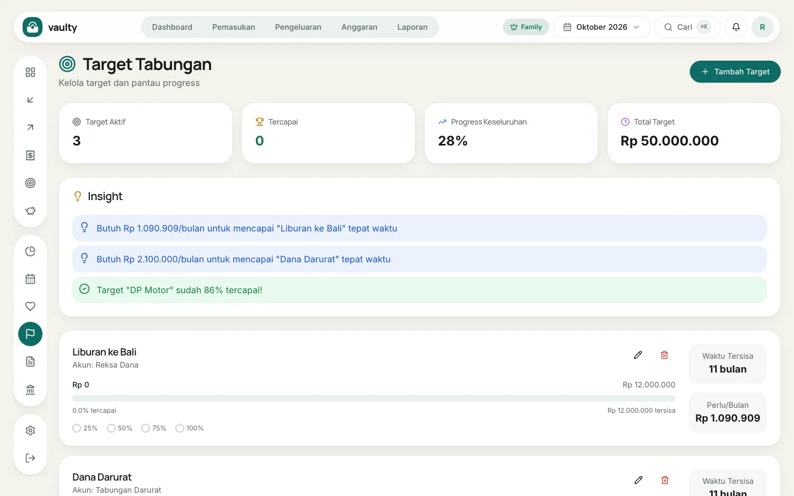
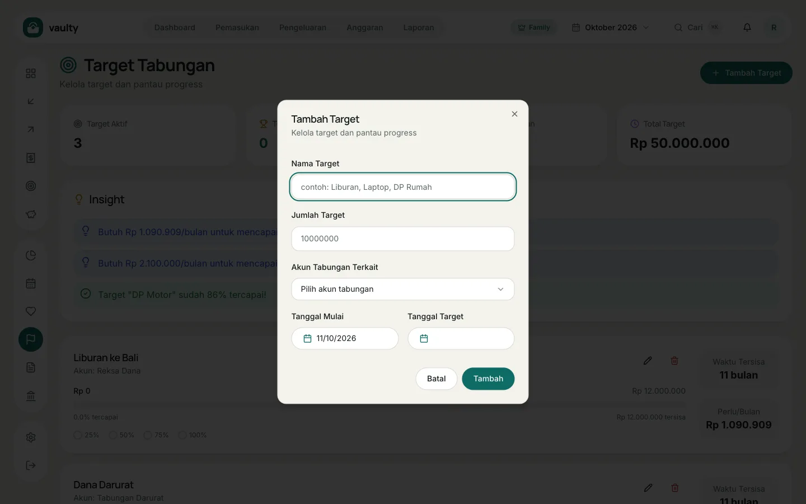

Dua menu yang bekerja berpasangan: **Tabungan** untuk mencatat uang yang ditabung atau diinvestasikan, dan **Target** untuk tujuan yang ingin dicapai. Keduanya untuk paket **Personal** ke atas.

## Mencatat tabungan

1. Buka **Tabungan** dan klik **Tambah Tabungan**.
2. Pilih **Tanggal** dan **Jenis** (**Tabungan** atau **Investasi**).
3. Isi **Nama Tabungan**, misalnya "Tabungan Darurat" atau "Reksa Dana". Kalau nama itu sudah pernah dipakai, akan muncul sebagai saran di bawah kolom supaya tidak perlu mengetik ulang dan tidak kecatat sebagai akun terpisah karena beda ejaan.
4. Isi **Setoran** untuk uang yang masuk, atau **Penarikan** untuk uang yang diambil. Titik ribuan muncul otomatis saat mengetik, supaya nominal besar lebih mudah dibaca.
5. Klik **Tambah**.

Saldo tiap akun dihitung dari setoran dikurangi penarikan, dan tampil di kartu di atas daftar.

Uang yang kamu tarik dari tabungan atau investasi masuk ke saldo dompet, tetapi **tidak dihitung sebagai pemasukan**. Total Pemasukan, grafik arus kas, dan skor kesehatan keuangan hanya menghitung uang yang benar-benar baru masuk, seperti gaji atau bonus.

## Membuat target

1. Buka **Target** dan klik **Tambah Target**.
2. Isi **Nama Target** (misalnya "Liburan ke Bali") dan **Jumlah Target**.
3. Pilih **Akun Tabungan Terkait**: saldo akun itulah yang dihitung sebagai progres.
4. Pilih **Tanggal Mulai** dan **Tanggal Target**.
5. Klik **Tambah**.

Tiap target menampilkan progres, **Waktu Tersisa**, dan **Perlu/Bulan**: berapa yang harus ditabung tiap bulan agar sampai tepat waktu. Bagian **Insight** di atas memberi tahu target yang hampir tercapai.

## Sisihkan rutin ke target (Personal ke atas)

Di kartu target, **Sisihkan rutin** mengatur jumlah tetap yang disisihkan tiap bulan pada tanggal tertentu, atau tiap kali gaji masuk. Pada hari itu Vaulty mengingatkanmu, lalu kamu klik **Sudah disisihkan** dan sebuah transfer ke rekening target tercatat. Mode **otomatis** hanya untuk yang memakai autodebet, karena Vaulty mencatat uang dan tidak memindahkannya.

## Target bersama (Family)

Hubungkan target ke sebuah rekening, lalu anggota keluarga bisa membuat **janji setoran**: berapa dan paling lambat kapan. Janji **ditepati** kalau anggota itu mencatat transfer ke rekening target antara 31 hari sebelum sampai 7 hari sesudah jatuh tempo, dengan selisih jumlah paling besar 1%. Lewat 7 hari tanpa transfer, janji ditandai **lewat waktu**. Panel target menampilkan progres tiap anggota.

Uang yang **keluar** dari rekening target (transfer keluar atau pengeluaran) masuk ke daftar yang perlu dijelaskan. Anggota menjawab untuk apa: keperluan target, dipinjam dan akan dikembalikan, atau lainnya dengan catatan. Rekening yang dipakai harian (tunai, e-wallet, atau banyak pengeluaran) diberi peringatan, karena tabungan bersama sebaiknya di rekening khusus.
