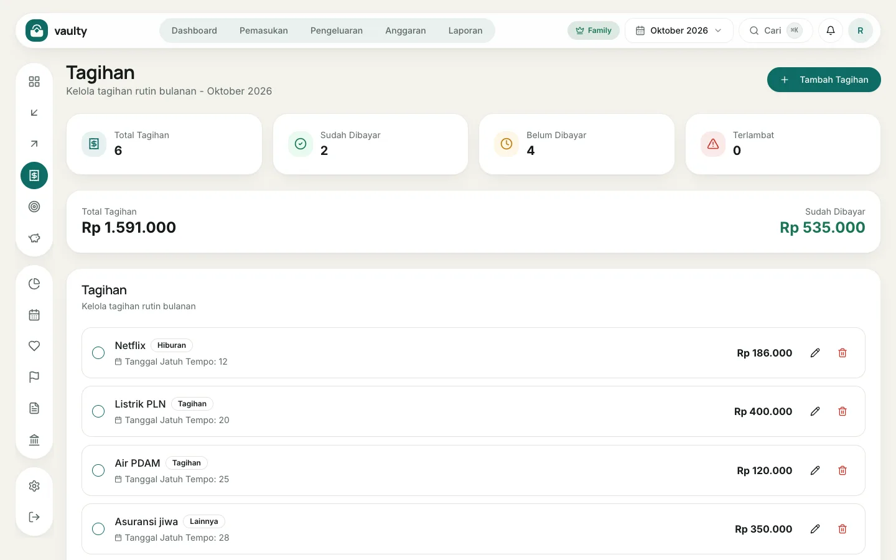
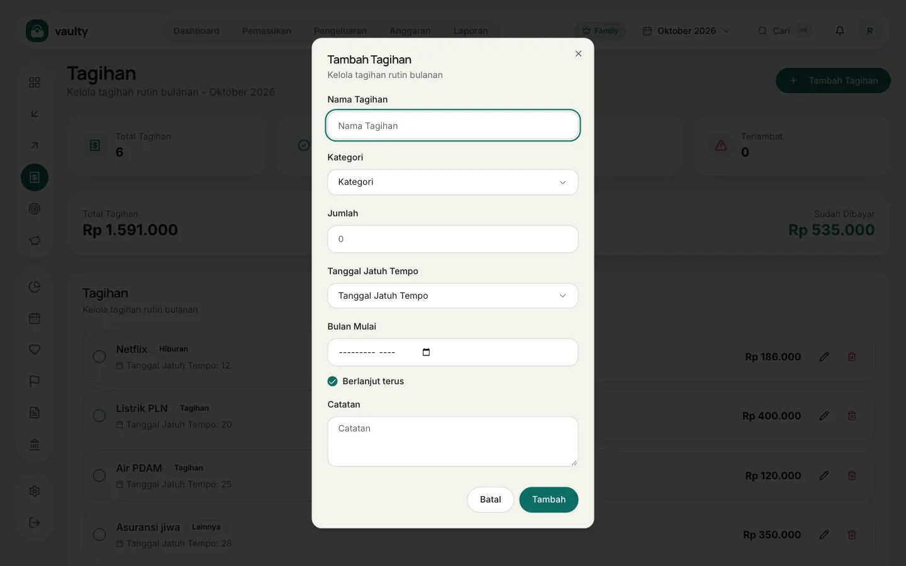

**Tagihan** untuk pengeluaran rutin seperti listrik, internet, dan langganan, supaya tidak ada yang terlewat. Tersedia di paket **Personal** ke atas.

## Menambah tagihan

1. Buka **Tagihan** dan klik **Tambah Tagihan**.
2. Isi **Nama Tagihan**, **Kategori**, dan **Jumlah**.
3. Pilih **Tanggal Jatuh Tempo** (1 sampai 31) dan **Bulan Mulai**.
4. Biarkan **Berlanjut terus** menyala untuk tagihan tanpa tanggal berakhir, atau matikan dan isi bulan berakhir.
5. Klik **Tambah**.

## Menandai lunas

Klik lingkaran di kiri nama tagihan. Tagihan berubah **Sudah Dibayar** (dicoret), dan pembayarannya dicatat sebagai pengeluaran bulan itu.

## Membaca ringkasan

Empat kartu di atas menunjukkan **Total Tagihan**, **Sudah Dibayar**, **Belum Dibayar**, dan **Terlambat**. Tagihan yang lewat jatuh tempo tanpa pembayaran diberi label merah **Terlambat**, dan tagihan yang mendekati jatuh tempo muncul di kartu **Tagihan mendatang** di dashboard.

## Tagihan yang kami temukan

Kalau pola pengeluaranmu terlihat seperti tagihan rutin (muncul minimal 3 kali di bulan berbeda, jarak 25 sampai 35 hari, jumlah mirip), Vaulty menawarkannya di panel **Tagihan yang kami temukan**. Klik **Terima** untuk menjadikannya tagihan, atau **Abaikan** supaya tidak disarankan lagi. Tombol **Cari tagihan** memeriksa ulang sekarang; selain itu Vaulty memeriksa sendiri tiap 6 jam.

Setelah diterima, pengeluaran 40 hari terakhir yang cocok otomatis dicatat sebagai pembayaran bulannya. Kalau harganya naik dan dua pembayaran terakhir sudah di harga baru, tagihan hasil deteksi langsung diperbarui, sedangkan tagihan yang kamu buat sendiri hanya diberi pemberitahuan dengan pilihan **Pakai harga baru** atau **Biarkan**.

## Kalender tagihan di aplikasi kalender

Klik **Buat link kalender**, lalu tambahkan link itu ke Google Calendar, Apple Calendar, atau Outlook lewat "tambah kalender dari URL". Tagihan aktifmu tampil di kalender, dari 2 bulan lalu sampai 12 bulan ke depan. Bulan yang sudah lunas diberi centang, dan tagihan yang belum lunas mendapat pengingat sehari sebelumnya.

Link-nya hanya tampil **sekali** dan bersifat rahasia, jadi simpan dengan hati-hati. **Buat link baru** langsung mencabut link lama, dan **Matikan** menghentikannya sama sekali.
